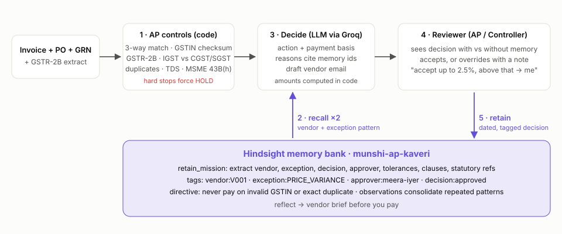

# Munshi: the accounts payable agent that remembers every exception

> *Munshi* (मुंशी): the old-school Indian accountant who remembered every vendor's quirks.

Every Indian AP team has one senior person who just *knows* things:
"Shree Balaji's 2% overbilling is the April escalation clause, approve it."
"Deccan Steel always files GSTR-1 late, so pay the base and hold the GST."
"Coastal will re-issue if you cite Annexure B."
When that person is on leave, invoices pile up and get escalated to the CFO's desk.

Munshi is an AP exception agent built on [Hindsight](https://github.com/vectorize-io/hindsight) agent memory. It runs the
deterministic controls a finance team already trusts. When an invoice fails one, Munshi **recalls how your
people resolved the same vendor and the same kind of exception before**, decides, and shows its work. Every
human decision becomes a dated, tagged memory, so the next invoice is handled better.



## What it does

| Step | What happens | Memory? |
|---|---|---|
| 1. Controls | 3-way match (PO / GRN / invoice), **GSTIN checksum**, **GSTR-2B** presence, CGST+SGST vs IGST, duplicate and revision detection, **TDS section**, **MSME 45-day rule (Sec. 43B(h))** | No. Deterministic |
| 2. Recall | Two parallel Hindsight recalls: *vendor memory* (`vendor:V001`) and *exception-pattern memory* (`exception:PRICE_VARIANCE`), anchored at the invoice date | **Hindsight `recall`** |
| 3. Decide | LLM picks one of APPROVE / APPROVE_PARTIAL / REQUEST_VENDOR_CORRECTION / ROUTE_FOR_APPROVAL / HOLD, citing memory ids. Rupee amounts are computed in code, never by the model | Uses recalled memories |
| 4. Guardrails | Hard controls (invalid GSTIN, exact duplicate, wrong tax type) force HOLD whatever the model says. Citations to memories that weren't recalled are stripped | Hindsight directive + code |
| 5. Learn | Reviewer accepts or overrides with a note. The decision is retained with tags for vendor, exception, approver and outcome | **Hindsight `retain`** |
| 6. Brief | "What should I know before paying this vendor?" | **Hindsight `reflect`** |

The UI runs every invoice **twice, with and without memory**, side by side. That before/after comparison is the point.

## The story the data tells

The repo ships a realistic AP book for *Kaveri Precision Components Pvt Ltd* (Bengaluru): 7 vendors with
valid GSTINs, Udyam numbers, HSN/SAC codes, POs, GRNs and a GSTR-2B extract. History runs from August to
October 2026, followed by a live queue for November.

| November invoice | Without memory | With Hindsight memory |
|---|---|---|
| Shree Balaji, price +2.2% | Escalate to Head of Procurement | **Approve.** Clause 7.2 escalation, Meera's 2.5% tolerance (Sep 3) |
| Shree Balaji, price +4.1% | Escalate | Escalate **to Meera specifically**: exceeds her 2.5% rule |
| Coastal Freight, fuel surcharge 9.6% | Escalate | **Ask vendor to correct.** Draft email cites Annexure B 8% cap; they re-issued at 7.5% last time |
| Deccan Steel, not in GSTR-2B | Hold whole invoice | **Pay ₹9.18L taxable, hold ₹1.65L GST** until 2B reflects (Controller's standing rule) |
| Sri Lakshmi, `SLE/1342-R` "duplicate" | Escalate as possible duplicate | **Approve.** `-R` is their revision convention, original was rejected |
| Nimbus, TDS section unclassified | Escalate to Controller | **Approve under 194J(b)** per the tax consultant's 9 Oct opinion |
| Apex, billed 80 / received 64 | Escalate | **Pay for 64, request credit note.** Apex always ships the balance |
| Vrindavan Trading, bad GSTIN check digit | Hold | **Hold.** Memory cannot override a hard control |

Note the second and last rows. Memory makes Munshi more autonomous, but it also makes it more precise about
*when not to be* autonomous.

## How Hindsight is used

All memory code is in [`munshi/memory.py`](munshi/memory.py).

**Bank setup.** One bank per company, configured so extraction keeps what AP needs:

```python
await client.acreate_bank(
    bank_id,
    retain_mission="...extract the vendor, exception type, decision, who decided, numeric tolerances, "
                   "contract clauses, statutory references (GST, GSTR-2B, TDS, MSME 43B(h))...",
    reflect_mission="You brief an AP executive before they process a vendor's invoice...",
    background="Kaveri Precision Components... Owners: Meera Iyer for price, Arjun Rao for freight...",
    enable_observations=True,
)
await client.acreate_directive(bank_id, name="hard-controls", content="Never recommend paying an invoice whose "
                               "supplier GSTIN fails validation, or one that is an exact duplicate...", priority=10)
```

**Retain: every human decision, dated and tagged.**

```python
await client.aretain(
    bank_id=bank, content=narrative,               # who decided what, why, which controls failed
    timestamp=decision_date + "T17:00:00",        # memory lives on the business timeline
    document_id=f"decision-{invoice_id}",         # re-deciding an invoice replaces, not duplicates
    tags=["vendor:V001", "exception:PRICE_VARIANCE", "approver:meera-iyer", "decision:approved"],
)
```

**Recall: two axes in parallel, strictly scoped by tag, anchored at the invoice date.**

```python
vendor  = arecall(q_vendor,  tags=["vendor:V001"],              tags_match="any_strict", query_timestamp=received)
pattern = arecall(q_pattern, tags=["exception:PRICE_VARIANCE"], tags_match="any_strict", query_timestamp=received)
```

Vendor memory carries vendor-specific rules. Pattern memory carries "how do we usually handle this kind of
problem, and who owns it". The prompt says outright that a tolerance learned for one vendor never transfers to
another. The Balaji +4.1% case shows the agent respecting a learned *ceiling*.

**Reflect: vendor brief.** `areflect(bank, "Brief me on <vendor>...", tags=["vendor:V00x"])` gives a
synthesised briefing over that vendor's whole history.

**Memory is earned, not imported.** `scripts/replay_history.py` replays August to October in date order through
the same agent path a live reviewer uses: analyse with memory as it stands, then retain the real human
decision. The learning curve tab plots the result.

## Run it

```bash
python3 -m venv .venv && source .venv/bin/activate
pip install -r requirements.txt
cp .env.example .env                 # plug in your keys (see below)
python scripts/check_setup.py        # verifies Hindsight + LLM respond
python scripts/replay_history.py     # builds the bank from Aug-Oct decisions (~2-4 min)
uvicorn munshi.server:app --port 8000
# open http://localhost:8000, then click any November invoice, then Run Munshi
pytest -q                            # controls, guardrails, citation stripping, fallbacks
```

**Keys** (`.env`):

| Variable | Where to get it |
|---|---|
| `HINDSIGHT_API_KEY` | [Hindsight Cloud](https://ui.hindsight.vectorize.io) → API keys |
| `LLM_API_KEY` | [Groq](https://console.groq.com/keys) (free tier), or any OpenAI-compatible provider via `LLM_BASE_URL` / `LLM_MODEL` |

Without keys the app still runs: controls work, and every exception is safely escalated with the reason shown.

**Docker:** `docker compose up --build` (Hindsight Cloud), or fully self-hosted with the open-source Hindsight server:
`HINDSIGHT_URL=http://hindsight:8888 docker compose --profile selfhost up --build`.

**Demo path (3 minutes):** SBP/0588 (+2.2%) → SBP/0601 (+4.1%) → Deccan GSTR-2B → Coastal surcharge email →
Vrindavan invalid GSTIN → record a decision → Vendor brief → Learning curve. Full script in
[`content/video_script.md`](content/video_script.md).

## Engineering choices

- **The model never does arithmetic.** It chooses a *payment basis* (FULL / EXCLUDE_GST / EXCLUDE_DISPUTED /
  NONE). Rupees are computed in code.
- **Hard controls are code, not prompts.** A failing GSTIN forces HOLD even if the model says APPROVE, and
  the UI shows that the guardrail fired.
- **Citations are verified.** Every reasoning point cites a memory id. Ids that weren't actually recalled are
  removed and counted.
- **Degrades safely.** If the LLM is rate-limited or Hindsight is unreachable, the invoice is routed to its
  default owner with the reason shown. It is never silently approved.
- **Clean invoices skip the LLM.** Straight-through processing costs nothing.

## Layout

```
munshi/rules.py     deterministic AP controls (GSTIN mod-36 checksum, 2B, 3-way match, TDS, MSME)
munshi/memory.py    Hindsight: bank, directive, retain, dual recall, reflect
munshi/agent.py     controls -> recall -> decide -> guardrails -> amounts
munshi/server.py    FastAPI API + static UI
web/                single-page review UI (no build step)
scripts/            synthetic AP book generator, history replay, setup check
tests/              pytest
content/            article, LinkedIn post and demo video script
```

Links: [Hindsight on GitHub](https://github.com/vectorize-io/hindsight) · [Hindsight docs](https://hindsight.vectorize.io/) · [What is agent memory](https://vectorize.io/what-is-agent-memory)
