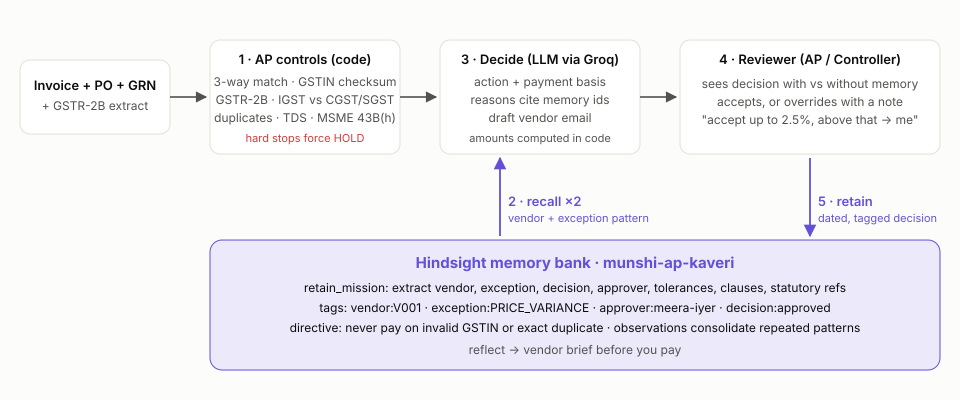

# I gave my AP agent the memory of a 20-year accountant, using Hindsight

Every finance team in India has one person who knows that Shree Balaji's 2% overbilling isn't overbilling.
It's the April escalation clause nobody updated in the PO master. When that person goes on leave, the
invoice gets escalated to the Head of Procurement, who approves it with the same sentence they wrote last
month. Then the invoice after that gets escalated too.

I built Munshi to fix that loop. Munshi is an accounts payable exception agent that remembers how your people resolved every
exception, per vendor, with dates and names, and applies it the next time. It's built on
[Hindsight agent memory](https://github.com/vectorize-io/hindsight). This post covers how it fits together,
and why the interesting part turned out to be teaching the agent *when not to* use what it remembers.

## The problem isn't matching, it's remembering

Three-way matching (PO, goods receipt, invoice) is a solved problem. Every ERP flags a 2% price variance. What
ERPs don't do is remember what happened *after* the flag:

- Meera from procurement said Balaji's escalation is capped at 2.5% under clause 7.2, and anything above
  that goes to her.
- Deccan Steel files GSTR-1 late, so their invoices miss our first GSTR-2B. The controller's rule: release
  the taxable value and hold only the GST until it reflects.
- Coastal Freight's diesel surcharge is allowed up to 8% under Annexure B. When they billed 11.2%, we pushed
  back and they re-issued at 7.5% in two days.
- Sri Lakshmi Electricals re-sends corrected invoices with a `-R` suffix. That isn't a duplicate.

That knowledge lives in email threads and in one person's head. It's exactly the kind of thing that
[agent memory](https://vectorize.io/what-is-agent-memory) is for.

## How Munshi hangs together

The pipeline has five steps, and only two of them involve an LLM:

1. **Deterministic controls** run first: three-way match, a GSTIN mod-36 checksum, GSTR-2B presence,
   CGST+SGST vs IGST by place of supply, duplicate and revision detection, TDS section, and the MSME 45-day
   payment limit under Section 43B(h). This is plain Python. Finance teams trust it because it is boring.
2. **Recall** from Hindsight, along two axes in parallel.
3. **Decide**: the LLM picks an action and cites the memories it used.
4. **Guardrails** in code override the model where they must.
5. **Retain**: the reviewer accepts or overrides with a note, and that note becomes memory.



## Memory with two axes

The obvious design is one recall: "everything relevant to this invoice". The trouble is that semantic similarity
doesn't respect vendor boundaries. Sri Lakshmi's price variance *looks* a lot like Shree Balaji's, so the 2.5%
tolerance Meera gave Balaji is exactly what a single similarity search would surface. In AP, a rule applied
to the wrong vendor is how money leaks.

So every decision is retained with structured tags, and recall runs along two separate axes:

```python
tags = [vendor_tag(vendor["id"]), *[exception_tag(c) for c in codes],
        f"approver:{decision['by'].lower().replace(' ', '-')}", f"decision:{decision['decision'].lower()}"]
await self.client.aretain(
    bank_id=self.bank,
    content="\n".join(lines),
    timestamp=decision["date"] + "T17:00:00",
    context="Accounts payable exception resolution by a human reviewer",
    document_id=f"decision-{inv['id']}",
    tags=tags,
    update_mode="replace",
)
```

At decision time, *vendor memory* (`vendor:V001`) answers "what has this supplier taught us?" and *pattern
memory* (`exception:PRICE_VARIANCE`) answers "how do we handle this kind of problem, and who owns it?":

```python
tasks = [self._recall(vendor_q, [vendor_tag(vendor["id"])], when, "vendor")]
if codes:
    pattern_q = f"Past resolutions and owners for AP exceptions: {issues}."
    tasks.append(self._recall(pattern_q, [exception_tag(c) for c in codes], when, "pattern"))
results = await asyncio.gather(*tasks)
```

Two details mattered more than I expected. `tags_match="any_strict"` keeps untagged memories out of a scoped
recall. And `query_timestamp` is set to the invoice's received date, not wall-clock time, so recency is
measured on the business timeline. A decision from six weeks ago really is six weeks old.

The UI labels each recalled memory "this vendor" or "similar exception", and the system prompt says it outright:
*a tolerance learned for one vendor does not transfer to another.*

## Hindsight does the extraction I didn't want to write

I didn't write a schema for "AP decisions". The bank is created with a `retain_mission` telling Hindsight what
matters in this domain:

```python
RETAIN_MISSION = (
    "You are the institutional memory of an Indian accounts payable team. From each record, extract: "
    "the vendor, the exception type, the decision (approved / partially paid / rejected / held), who decided and "
    "their role, numeric tolerances or thresholds stated (percentages, caps, day counts), contract or clause "
    "references, statutory references (GST, GSTR-2B, TDS sections, MSME 43B(h)), what the vendor did afterwards, "
    "and any standing instruction for next time. Keep amounts, dates, invoice and clause numbers exact."
)
```

The reviewer writes a sentence like "Accept SBP variance up to 2.5%; anything above comes to me." Hindsight
turns it into facts with entities and time. The [Hindsight docs](https://hindsight.vectorize.io/) cover
the extraction, entity linking and observation consolidation that runs behind `retain`. I didn't have to
build any of it.

For the "brief me before I pay this vendor" button I use `reflect` scoped to the vendor's tag. It returns a
synthesised briefing, not a list of hits.

## What the model is not allowed to do

Finance people will not trust an agent that does arithmetic in a prompt, or one that can talk itself past a
control. So:

- **The model never computes rupees.** It chooses a *payment basis* (`FULL`, `EXCLUDE_GST`,
  `EXCLUDE_DISPUTED`, `NONE`) and code computes the amounts.
- **Hard controls are code, not prompts.** An invalid GSTIN forces `HOLD` even if the model says approve,
  and the UI shows that the guardrail fired:

```python
if summary["hard_stop"] and decision["action"] != "HOLD":
    decision["guardrail"] = f"Model proposed {decision['action']}; forced to HOLD because a hard control failed."
    decision["action"], decision["payment_basis"] = "HOLD", "NONE"
```

- **Citations are checked.** Every reasoning point cites memory ids. Any id that wasn't actually recalled is
  stripped and counted, so a hallucinated "per our policy" can't hide.
- **Failure means escalation, never approval.** If the LLM is rate-limited or Hindsight is unreachable, the invoice goes to
  its default owner with the reason shown.

## Before and after

The UI runs every invoice twice, with the same model and the same prompt, once with memory and once
without, and shows them side by side. On the November queue:

- **Shree Balaji, +2.2% on boxes.** Without memory: escalate to procurement. With memory: approve, citing the
  clause 7.2 escalation and Meera's 2.5% tolerance from September.
- **Shree Balaji, +4.1%.** With memory, it *still* escalates, but now to Meera by name, because it's above
  her ceiling. This was the case that convinced me memory makes the agent more precise, not just more permissive.
- **Coastal Freight, 9.6% fuel surcharge.** Without memory: escalate. With memory: a vendor-correction email
  citing Annexure B and noting they re-issued at 7.5% last time.
- **Deccan Steel, missing from GSTR-2B.** Without memory: hold the whole invoice. With memory: pay the taxable
  value, hold the GST. On this invoice that's ₹9.18 lakh released and ₹1.65 lakh held.
- **Vrindavan Trading, wrong GSTIN check digit.** Hold, with or without memory. A new vendor has no memory to
  lean on, and no memory could override that control anyway.

## Memory is earned, not imported

I could have bulk-loaded three months of decisions. Instead, `replay_history.py` walks August to October in
date order through the same path a live reviewer uses: analyse with memory as it stands, then retain the human's
real decision. The learning-curve tab plots the running share of exceptions resolved without a senior approver.
You can watch it climb as the bank fills.

## Lessons

1. **Scope your recall before you tune your prompt.** Most of the bad answers I saw came from the wrong memories
   arriving, not from bad reasoning. Tagging by vendor and by exception fixed more than any prompt change did.
2. **Put memory on the business clock.** `timestamp` on retain and `query_timestamp` on recall turned
   "recent" into something an accountant would agree with.
3. **A learned rule is a ceiling as well as a permission.** The best demo moment is the agent refusing to
   auto-approve because it remembers the limit.
4. **Keep controls deterministic, and make the memory explain them.** The LLM is the part that reads
   the note your controller wrote in September. It is not the part that decides whether a GSTIN is valid.
5. **The reviewer's note is the product.** I made the note mandatory on overrides. That one sentence
   is the training signal.

Munshi is open source. The controls, memory layer and UI are in the repo. If you run AP for a mid-market
company, I'd like to hear which exceptions eat your team's week.
